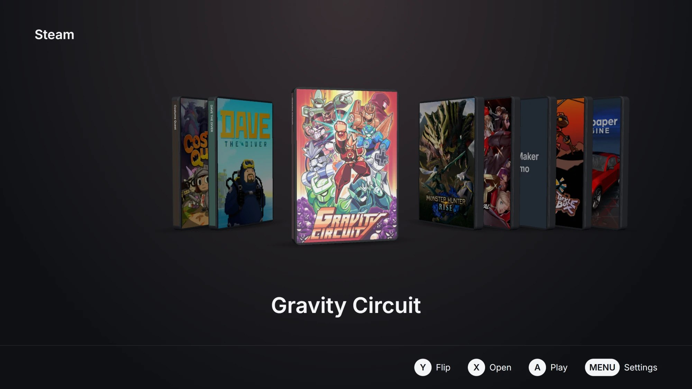

<p align="center">
  
</p>

<h1 align="center">Tink</h1>

<p align="center">
  <a href="https://github.com/ObsidianAli/tink-emulator-frontend/releases/latest"><b>Download</b></a>
</p>

Grab `Tink.zip`, unzip it and run `Tink.exe`. Emulators not included.

## Profiles

Tink asks who's playing when it starts. Each profile has its own Recent, Favourites and hidden games: L3 (L) favourites a game, R3 (H) hides it and View (Tab) switches profile. For a picture, drop a PNG or JPG into `data/avatars` and pick it when you edit the profile.

## Covers

Covers come from libretro. For the newer consoles it doesn't have much, so you can add a free SteamGridDB key in Settings. Tink only goes online for covers and to check for updates.

## Running from source

```
npm ci
npm start
```
